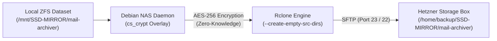

# Debian NAS (Debian 13 "Trixie" + Go + HTMX)

[🇩🇪 Zur deutschen Version wechseln](README.md)

An uncompromisingly fast, lightweight NAS operating system frontend and daemon built on **Debian 13 (Trixie)**, native **OpenZFS** storage architecture, **Samba**, **NFS**, and **Rclone** — engineered for peak performance, intuitive configuration, and **real, working HDD spindown/standby**.

---

## Highlights

* **OpenMediaVault 6 / 7 Dark Dashboard Design:**
  * **Authentic OMV Design System:** Distinctive blue topbar (`#008be5`), dark charcoal sidebar (`#181818`), breadcrumb navigation (`🏠 | Dashboard`), and responsive 3-column dashboard grid.
  * **Real Dashboard Widgets:** CPU RRD graph, CPU utilization donut, concentric load average rings (1m, 5m, 15m), memory donut (with ZFS ARC auto-detection), active service pills (SSH, SMB, ZFS), system time, uptime, network interface overview, and S.M.A.R.T. physical disk tiles.
  * **100% English Web Interface:** Clean and consistent English terminology throughout the entire WebUI (Dashboard, tables, configuration modals, and notifications).
* **Native OpenZFS Foundation (First-Class Core Engine):**
  * **No Optional Plugin:** Unlike OpenMediaVault, where ZFS is only retrofitted through third-party plugins (omv-extras), OpenZFS in **Debian NAS** is the fundamental, native core storage system.
  * **Comprehensive ZFS Management:** Pools, VDEV topologies, datasets, zvols, point-in-time snapshots, clones, scrubbing, TRIM, and destructive action confirmation modals are directly built-in.
* **Modern Zero-JavaScript-Build Frontend (Go + HTMX + Alpine.js):**
  * **No Virtual DOM or SPA Overhead:** Clean, modular Go templates (`html/template`) instead of monolithic JavaScript frameworks.
  * **Flicker-Free Live Telemetry:** ZFS scrub progress, system metrics, and disk standby states update seamlessly without jumping or loss of UI focus.
  * **Alpine.js:** Lightweight client state management for tabs, modals, slide-over drawers, dropdowns, and toast notifications.
  * **Tailwind CSS v4:** Integrated via the official standalone CLI (no Node.js or npm required).
* **Real, Working HDD Standby (Power Saving that actually works):**
  * System and status telemetry queries **never** spin up sleeping drives (using non-intrusive `smartctl -n standby` and `hdparm -C`).
  * All ZFS datasets are created with **`atime=off`** by default so read operations do not permanently keep hard drives awake.
  * Automatic spindown management via `hd-idle` with configurable per-disk timers (5m to 2h, or Always On).
  * Global firmware APM & EPC disabling on boot to prevent disks from waking themselves up every 30 minutes.
  * 60-second SCSI device timeout (`udev`) and `failmode=wait` to safely bridge 15–20s spin-up delays of large helium enterprise drives without ZFS I/O freezes.
* **Single-Binary Architecture (Go):**
  * The entire daemon including the WebUI (HTML templates, CSS, icons, HTMX, Alpine) compiles into **a single static binary** (`nasd`).
  * Startup time: < 10 milliseconds.
  * Idle RAM usage: **only ~15–25 MB RSS**.
* **Notifications, Jobs & System Center (Topbar Bell Dropdown):**
  * **Live Status Indicator:** Real-time badge dot (pulsing blue when jobs are active, red for critical alerts, amber for warnings, green for all healthy).
  * **Running Jobs:** Live tracking of ZFS Scrubs (with percentage progress bars), Rclone Cloud Sync tasks, and S.M.A.R.T. self-tests.
  * **Completed Jobs:** History of finished scrubs, completed cloud backups, and periodic snapshot tasks with timestamps.
  * **System Alerts & Errors:** Instant detection of degraded pools, disk I/O errors, high disk temperatures, and high pool capacity.
  * **Event Log:** Chronological activity stream with a 1-click "Clear Log" action.
* **File Shares & User Management:**
  * **Samba (SMB):** Native Windows network discovery (`wsdd2`), macOS Time Machine support, and granular user/guest permissions.
  * **NFS Kernel Server:** Low-latency exports for Linux clients, Proxmox VE, and virtualization clusters.
* **TrueNAS-Style Cloud Sync Tasks (Bare-Metal Rclone Engine):**
  * **100% Linux Native & Container-Free:** Maximum throughput and minimal latency through direct OS process execution on Debian 13.
  * **Multi-Cloud & SFTP Support:** Ready-to-use profiles for **Hetzner Storage Box (SFTP)**, Nextcloud/ownCloud (WebDAV), Backblaze B2, Amazon S3 / S3-compatible object storage (MinIO, Wasabi, Cloudflare R2), Google Drive, and Microsoft OneDrive.
  * **Standard TrueNAS Transfer Modes:**
    * `COPY`: Safely copies new and changed files; remote files are never deleted (Safe Mode).
    * `SYNC`: Exact 1:1 mirror; files deleted locally are pruned from remote storage.
    * `MOVE`: Moves files after successful upload to free up local disk space.
  * **Zero-Knowledge Client-Side Encryption (AES-256 Rclone Crypt):**
    * In-memory encryption/decryption before network transfer via dynamic crypt overlays (`cs_crypt_<id>`). The cloud provider stores only unreadable cipher blocks.
    * Full separation of Encryption Passphrase and cryptographic Master Salt.
  * **Granular Filename Encryption:**
    * `Off (Plain Names)`: Folder and file names remain human-readable on Hetzner/Cloud for easy navigation, while all file contents are strictly AES-256 encrypted.
    * `Standard`: Obfuscates both file contents and directory hierarchies using AES-256-EME.
    * `Obfuscate`: File name obfuscation for storage targets with length or character limitations.
  * **Automatic Dataset Hierarchy Mapping (`/backup/<Pool>/<Dataset>`):**
    * Automatic path expansion and 1-click normalization (`🔄 Dataset Path`) to mirror ZFS hierarchies cleanly on remote storage.
  * **Empty Directory Replication (`--create-empty-src-dirs`):**
    * Replicates newly created, empty folders and datasets reliably.
  * **Instant Task Abort & Dry-Run Mode:**
    * Cancel running uploads instantly via OS signals (`SIGTERM`/`SIGKILL`), and test transfers safely using `--dry-run`.
* **Hardware-Agnostic Storage Management:**
  * Disks identified via persistent paths (`/dev/disk/by-id/`).
  * 45Drives Houston chassis & drive-bay identification, S.M.A.R.T. testing, and locate LED support.

---

## Project Structure

```text
Debian-Nas/
├── backend/
│   ├── cmd/nasd/main.go            # Daemon entry point
│   ├── internal/
│   │   ├── api/                    # REST API & HTMX UI Handlers
│   │   │   ├── api.go
│   │   │   ├── ui_handlers.go
│   │   │   └── notifications_test.go
│   │   ├── web/                    # Go Template Engine & Web Assets
│   │   │   ├── web.go              # //go:embed templates/* & static/*
│   │   │   ├── templates/          # Modular HTML templates
│   │   │   │   ├── layout.html     # Master cockpit layout & Alpine state
│   │   │   │   ├── partials/       # Topbar, notifications, metrics, pools, disks, etc.
│   │   │   │   └── modals/         # 13 modal dialogs (Shares, Pools, Disks, Snaps)
│   │   │   └── static/             # Embedded assets (HTMX, Alpine, CSS)
│   │   │       ├── htmx.min.js
│   │   │       ├── alpine.min.js
│   │   │       ├── tailwind.css    # Compiled Tailwind CSS
│   │   │       ├── style.css       # PatternFly Enterprise theme
│   │   │       └── input.css       # Tailwind source CSS
│   │   ├── zfs/                    # OpenZFS pools, datasets, scrubs & failmode
│   │   ├── disks/                  # HDD detection, standby check, SMART, spindown
│   │   ├── shares/                 # Samba (smb.conf), NFS (/etc/exports) & user management
│   │   ├── cloudsync/              # Rclone integration (B2, Drive, S3, SFTP)
│   │   ├── config/                 # Configuration manager
│   │   └── system/                 # Linux kernel telemetry & networking
│   ├── static/                     # Synchronous asset mirror
│   ├── go.mod
│   └── go.sum
├── debian/
│   ├── install.sh                  # 1-Click installer for Debian 13 (/opt/debian-nas)
│   └── nasd.service                # Systemd service unit
├── scripts/
│   ├── build-css.sh                # Tailwind standalone CLI builder (Linux)
│   └── build-css.ps1               # Tailwind standalone CLI builder (Windows)
├── Makefile                        # Build, CSS, and deployment targets
├── README.md                       # German documentation (with English switcher)
└── README.en.md                    # English documentation
```

---

## Quickstart on Debian 13 (Trixie)

### 1. Install Minimal Debian 13
Install Debian 13 (e.g. via minimal Netinst ISO) on a dedicated boot SSD/NVMe.

### 2. Clone Repository to `/opt/debian-nas` & Run Installer
```bash
sudo git clone https://github.com/MrCoopa/Debian-NAS.git /opt/debian-nas
cd /opt/debian-nas
sudo ./debian/install.sh
```

The script will automatically:
1. Enable `contrib` and `non-free-firmware` in package repositories.
2. Install `zfsutils-linux`, `samba`, `wsdd2` (or `wsdd`), `nfs-kernel-server`, `hd-idle`, `smartmontools`, `fio`, and `rclone`.
3. Set up global HDD wake-up protection (`99-hdd-timeout.rules` with 60s timeout, `@reboot` APM/EPC disabling).
4. Compile the static Go binary to `/opt/debian-nas/bin/nasd` (symlinked to `/usr/local/bin/nasd`).
5. Configure Samba with `/etc/samba/nas-shares.conf` and Windows network discovery.
6. Install and enable the `nasd.service` systemd unit and start it immediately.

### 3. Open Web Interface
Open your web browser and navigate to:
```text
http://<nas-ip-address>:8080
```

---

## Updating an Existing Server

To update your running installation with the latest commits from the Git repository:

```bash
cd /opt/debian-nas
git pull
sudo ./debian/install.sh
```

Alternatively, you can rebuild the binary directly without running the full installer:

```bash
cd /opt/debian-nas
git pull
sudo systemctl stop nasd.service
cd backend && CGO_ENABLED=0 go build -v -ldflags="-s -w" -o ../bin/nasd ./cmd/nasd
sudo systemctl start nasd.service
```

---

## TrueNAS & OpenZFS Pool Migration (Feature Flags & Upgrade Guide)

When importing a ZFS pool from an external system (such as **TrueNAS SCALE 24.10 "Electric Eel" or newer**), you may encounter this message:

```text
cannot import 'DATA': unsupported version or feature
This pool uses the following feature(s) not supported by this system:
com.truenas:block_cloning_endian (Fixes BRT ZAP endianness on new pools.)
All unsupported features are only required for writing to the pool.
The pool can be imported using '-o readonly=on'.
```

### Background
TrueNAS SCALE 24.10 uses OpenZFS 2.4+, which activates the `com.truenas:block_cloning_endian` feature flag. Debian 13 (Trixie) ships with OpenZFS 2.3.9 by default. Because ZFS feature flags are a one-way street, OpenZFS 2.3 blocks read-write imports to protect data integrity.

### Option A: Upgrade to OpenZFS 2.4.4 (Full Read & Write Access)
Debian **Sid (Unstable)** already packages OpenZFS **2.4.4**. Using **APT pinning**, we ensure that **only OpenZFS** is pulled from Sid while the rest of the OS remains 100% stable on Debian 13 (Trixie):

```bash
# 1. Add Sid repository
echo "deb http://deb.debian.org/debian sid main contrib non-free-firmware" | sudo tee /etc/apt/sources.list.d/sid.list

# 2. Configure APT pinning (Priority 100 = Sid packages are never installed automatically)
sudo tee /etc/apt/preferences.d/sid << 'EOF'
Package: *
Pin: release a=sid
Pin-Priority: 100
EOF

# 3. Update package index
sudo apt update

# 4. Install matching kernel headers for your running Trixie kernel
sudo apt install -y linux-headers-$(uname -r)

# 5. Selectively install OpenZFS 2.4 from Sid (builds kernel module for your 6.12 kernel)
sudo apt install -t sid -y zfs-dkms zfsutils-linux

# 6. Remove Sid sources (system stays 100% clean Trixie)
sudo rm -f /etc/apt/sources.list.d/sid.list /etc/apt/preferences.d/sid
sudo apt update

# 7. Reboot to load the newly compiled kernel module
sudo reboot
```

After rebooting, your NAS supports all TrueNAS 24.10+ features and the pool can be imported normally:
```bash
zpool import DATA
```

### Option B: Read-Only Import & Data Migration (Recommended for Standard Debian)
If you prefer not to mix packages from Sid:
1. **Import in Read-Only Mode:**
   - In the WebUI: Tick the **"Read-Only Import (-o readonly=on)"** option in the pool import dialog.
   - Via CLI:
     ```bash
     zpool import -f -o readonly=on DATA
     zfs mount -a
     ```
2. **Transfer data to your main pool:**
   ```bash
   rsync -avP /mnt/DATA/ /mnt/MEDIA-12TB/data/
   ```
3. **Destroy the old pool and recreate natively:**
   ```bash
   zpool destroy DATA
   ```
   Then create a fresh pool via **Storage Pools -> Create Pool** in the WebUI. It will be 100% natively compatible with Debian 13.

---

## HDD Standby & Power Management Guide

Debian NAS was designed from the ground up to ensure **real, reliable HDD spindown and standby**:

1. **Non-Intrusive Status Telemetry:**
   Dashboard and disk status checks only use `smartctl -n standby -i <disk>` and `hdparm -C <disk>`. These read status from the controller cache **without** waking sleeping drive spindles.
2. **S.M.A.R.T. Daemon Protection (`smartd`):**
   The background health monitor (`smartd`) in `/etc/smartd.conf` is automatically configured with `-n standby`:
   ```text
   DEVICESCAN -d removable -n standby -m root -M exec /usr/share/smartmontools/smartd-runner
   ```
   This prevents drives from waking up every 30 minutes for health checks.
3. **ZFS `atime=off`:**
   All datasets created via the WebUI or installer have `atime=off` enabled. Read accesses do not produce metadata writes that keep disks awake.
4. **Spindown Timers via `hd-idle`:**
   `/etc/default/hd-idle` manages the default spindown timeout (default: 1800 seconds = 30 minutes). The WebUI also allows per-disk timer configuration (Always On, 5m, 10m, 15m, 30m, 1h, 2h).
5. **Protection Against ZFS "SUSPENDED" on Wake-Up (SCSI Device Timeout & failmode):**
   * **The Challenge:** High-capacity helium enterprise HDDs (12TB–24TB) contain 8–10 spinning platters. Accelerating the spindle motor from 0 RPM to full speed takes **12 to 18 seconds**. By default, the Linux kernel aborts pending I/O operations after 30 seconds if a SATA handshake is delayed. This causes OpenZFS to encounter temporary I/O errors and suspend the pool (`failmode=wait`), freezing access (e.g. streaming to Jellyfin via NFS).
   * **The Solution in Debian NAS:**
     1. **Automatic 60s SCSI Block Timeout:** The kernel block device timeout (`/sys/block/sdX/device/timeout`) is automatically set to **60 seconds** via `/etc/udev/rules.d/99-hdd-timeout.rules`. The kernel waits patiently for the motor to reach operating speed before reporting any error.
     2. **SATA ALPM set to `max_performance`:** Prevents SATA physical link power-saving states from dropping the connection while the drive is sleeping, avoiding `COMRESET` dropouts on wake-up.
     3. **Pool `failmode=wait` Enforced:** All pools are configured with `failmode=wait` to queue I/O requests safely during spin-up.
     4. **1-Click Resume:** If a pool is ever suspended, it can be revived instantly with one click on **⚡ Resume Pool** (or via `zpool clear <pool>`).
6. **Global APM & EPC Disabling (Preventing Firmware-Driven Wake-Ups):**
   * **The Challenge:** Modern SATA and enterprise HDDs feature internal power management standards:
     1. **APM (Advanced Power Management):** Legacy ATA standard (e.g. WD Red, desktop HDDs).
     2. **EPC (Extended Power Conditions):** Modern ATA/SCSI standard (e.g. WD Ultrastar / Red Plus, Seagate Exos / IronWolf).
     Both technologies contain internal firmware timers (such as cyclic head parking or 30-minute wake-up cycles) that conflict with OS-level `hd-idle` management and spin up drives unexpectedly. Because drives reset these volatile settings after a reboot or power loss, disabling them must be automated at boot.
   * **Western Digital White Paper Reference (*Storage Power Efficiency Improvement With HDD Idle Modes*):**
     Western Digital documents 4 discrete EPC idle states for enterprise drives:
     | Mode | Description | Wake-up Latency | Power Draw (SATA) | WD Default Timer |
     | :--- | :--- | :--- | :--- | :--- |
     | **Idle_A** | Electronics throttled, spindle at full RPM | **0 s** (instant) | ~5.7 W | 2 seconds |
     | **Idle_B** | Spindle at 7200 RPM, heads parked (*Unloaded*) | **1.5 s** | ~3.8 W | **10 minutes (SATA)** |
     | **Idle_C / Standby_Y** | Low spindle RPM, heads parked | **4 s** | ~3.3 W | Disabled (*Never*) |
     | **Standby_Z** | **Full spindown (0 RPM)**, motor stopped | **15 s** | **~1.3 W** (-77% savings) | Disabled (*Never*) |

     > [!IMPORTANT]
     > **Endurance Limits:** Enterprise HDDs are rated for approximately **600,000 load/unload cycles** (head parking from `Idle_B`) and **50,000 start/stop cycles** (`Standby_Z`). Aggressive, short spindown timers (< 5 min) cause unnecessary mechanical wear. Debian NAS uses a balanced 30-minute timer via `hd-idle` and disables conflicting internal firmware timers (`Idle_B` auto-timers).

   * **Solution in Debian NAS:**
     * **Autostart Cronjob:** A `@reboot` root cronjob globally disables APM and EPC timers across all block devices on boot:
       ```bash
       @reboot for dev in /dev/sd[a-z]; do /usr/sbin/smartctl -s apm,off $dev 2>/dev/null; which sdparm >/dev/null 2>&1 && sdparm --flexible --set=STANDBY=0 $dev 2>/dev/null || true; done
       ```
     * **WebUI & Backend Detection:** Under **Physical Disks & S.M.A.R.T.**, the backend automatically detects whether a disk supports APM or EPC and allows targeted control or disabling.

---

## Network Services & Windows Discovery

* **Windows 10/11 Explorer Network Discovery (`wsdd2`):**
  On Debian 13 (Trixie), the legacy Python package `wsdd` has been replaced by the native, resource-efficient C implementation `wsdd2`. It is configured and started automatically so your NAS appears instantly under "Network" in Windows File Explorer.
* **Samba (SMB) File Shares:**
  Configured cleanly via `/etc/samba/nas-shares.conf`. Supports guest access, dedicated storage users (group `nasusers`), and macOS Time Machine backups.
* **NFS Kernel Server:**
  Exports configured under `/etc/exports.d/` for high-throughput, low-latency connections to Linux workstations, Proxmox VE, and Docker hosts.

---

## ZFS Snapshot Management & Pagination

* **Pool-Based Grouping:** Snapshots are automatically organized by storage pool in distinct tables.
* **Server-Side Pagination:** To keep the browser responsive even with hundreds of snapshots, the backend delivers **10 snapshots per page** with full pagination controls.
* **Live Search & Actions:** Search snapshots by name or dataset in real time, with 1-click **Rollback**, **Clone**, and **Destroy** actions.

---

## Cloud Sync & Hetzner Storage Box Guide (TrueNAS-Style Offsite Replication)

Debian NAS features a high-performance **Cloud Sync subsystem modeled after TrueNAS SCALE**, powered directly by the native **Rclone engine** on Debian (no Docker or virtualization overhead). It provides automated, encrypted offsite replication for your ZFS datasets to remote targets like **Hetzner Storage Box**, WebDAV/Nextcloud, Amazon S3, or Backblaze B2.



---

### 1. Setting Up Cloud Credentials (Example: Hetzner Storage Box SFTP)

Hetzner Storage Boxes offer cost-effective, high-availability storage with native SFTP/SSH access.

1. Navigate to **Cloud Sync Tasks** in the WebUI and click **+ Add Credential**.
2. Select **Provider:** `Hetzner Storage Box / SFTP`.
3. Fill in your connection details:
   * **Name:** A unique identifier without spaces (e.g. `Hetzner` or `StorageBox`).
   * **Host:** Your assigned hostname, e.g. `uXXXXXX.your-storagebox.de`.
   * **User:** Your Storage Box username, e.g. `uXXXXXX`.
   * **Port:** Default is `23` (Hetzner SFTP port) or `22`.
   * **Password:** Your Storage Box password or SSH key.
4. **Automatic Host Key Protection:** Debian NAS automatically configures `known_hosts_file=none`. This prevents background sync jobs from hanging on interactive SSH fingerprint prompts.
5. Click **Test Connection** to verify connectivity live, then save with **Save Credential**.

---

### 2. Configuring a Cloud Sync Task

In the *Cloud Sync Tasks* section, click **Add** to create a new task:

| Field | Description & Best Practices |
| :--- | :--- |
| **Description / Task Name** | A meaningful name (e.g. `Mail-Archiver -> Hetzner Backup`). |
| **Direction** | **`PUSH (Local NAS → Cloud)`** for offsite backups.<br/>**`PULL (Cloud → Local NAS)`** for disaster recovery and restore. |
| **Transfer Mode** | **`COPY (Safe - copy new/changed files only)`**: Copies new and modified files. Remote files are never deleted. Ideal for immutable long-term backups.<br/>**`SYNC (Exact mirror)`**: Exact 1:1 mirror. Files deleted locally are also removed from remote storage.<br/>**`MOVE`**: Moves files (deletes local source files after successful upload). |
| **Local Source Dataset** | The ZFS dataset to back up (e.g. `/mnt/SSD-MIRROR/Test`). The backend automatically normalizes paths to the correct `/mnt/` mount point (*Self-Healing*). |
| **Remote Credential** | The remote destination configured earlier (e.g. `Hetzner (sftp)`). |
| **Remote Folder / Subpath** | Destination directory on remote storage (e.g. `/backup/SSD-MIRROR/Test`). |
| **Bandwidth Limit** | Optional upload throttle (e.g. `50M` for 50 MB/s, `10M`, or `0` for unlimited). |
| **Frequency / Schedule** | Cron schedule (e.g. *Daily at 02:00 AM* or custom intervals). |

---

### 3. ZFS Dataset Hierarchy Mapping & Empty Folders

By default, Rclone transfers the **contents** of a source folder. Specifying `/backup` as the destination would dump the contents of `/mnt/SSD-MIRROR/Test/` directly into `/backup/` on the Storage Box, losing the folder name.

Debian NAS solves this with **automated path hierarchy**:
* Selecting a source dataset (e.g. `/mnt/SSD-MIRROR/Test`) automatically populates:
  $$\text{Remote Subpath} = \text{/backup/} + \langle\text{Pool}\rangle + \text{/} + \langle\text{Dataset}\rangle$$
* Example: `/mnt/SSD-MIRROR/Test` is mapped to `/backup/SSD-MIRROR/Test`, creating a clean directory structure on remote storage:
  ```text
  /home/backup/
  └── SSD-MIRROR/
      ├── mail-archiver/
      │   └── ...
      └── Test/
          └── Test/
  ```
* **Button `🔄 Dataset Path`:** Recalculates the optimal remote path with one click if the source dataset is changed later.
* **Empty Folders (`--create-empty-src-dirs`):** Automatically creates empty directories and newly created, empty ZFS datasets on remote storage.

---

### 4. Zero-Knowledge Client-Side Encryption (AES-256 Rclone Crypt)

Debian NAS protects your data on third-party cloud servers with true **client-side encryption**. Data is encrypted in memory before leaving the NAS; cloud providers only store unreadable ciphertext blocks.

#### How It Works Under the Hood
When **🔒 Client-Side Encryption** is enabled, the daemon dynamically creates an in-memory Rclone Crypt overlay (`cs_crypt_<taskID>`) that transparently encrypts data streams on the fly.

#### Key Management
* **Encryption Password:** Primary passphrase. In the edit dialog, the stored password can be revealed using the **👁️ Show / Hide** icon.
* **Master Salt:** A second, independent salt (Passphrase 2) to protect against dictionary and rainbow-table attacks.

#### Filename Encryption Modes
1. **`Off (Plain Names)` (Recommended for Hetzner Storage Box):**
   * **File Contents:** Cryptographically encrypted with **AES-256-CTR**. No one at Hetzner can read file contents.
   * **Folder & File Names:** Remain in plain text (`invoice_2026.pdf`, `Test/`, `mail-archiver/`).
   * **Benefit:** You can browse folder trees easily via SSH (`ls -la`), SFTP, or the Hetzner web file manager, while contents remain 100% protected.
2. **`Standard`:**
   * Both file contents and directory names are fully encrypted with **AES-256-EME** (e.g. `7k9f2b8a.../3p8m1c...`).
   * **Benefit:** Maximum confidentiality — third parties cannot infer file types or names.
3. **`Obfuscate`:**
   * Simple character obfuscation for targets with length or character set constraints.

---

### 5. Task Control, Live Monitoring & Instant Abort

* **Dry-Run Mode (`DRY`):** Simulates the transfer (`--dry-run`) without writing any files to verify the exact transfer list.
* **Instant Abort (`Abort`):** Immediately stops running uploads using OS signals (`SIGTERM` / `SIGKILL` / `pkill`) and transitions task state cleanly to `FAILED (Aborted by user)`.
* **Error Tooltips:** Hovering over a red `Failed` badge displays a detailed tooltip with the exact Rclone exit status and log output.

---

### 6. Disaster Recovery & Data Restore

If your NAS fails or data is accidentally lost, backups can be restored in two ways:

#### Method A: Via Debian NAS WebUI (PULL Task)
1. Create a new task with **Direction:** `PULL (Cloud → Local NAS)`.
2. Select your remote and subpath as the source (e.g. `/backup/SSD-MIRROR/mail-archiver`).
3. Select your local target ZFS dataset (e.g. `/mnt/SSD-MIRROR/mail-archiver`).
4. Enable **Client-Side Encryption** and enter the same password and salt.
5. Click **Run Now** — all data is downloaded, decrypted transparently, and restored to your dataset.

#### Method B: Standalone Restore via Rclone CLI (Any PC / Mac / Linux)
Because Debian NAS uses standard Rclone Crypt, you are **never locked in** and can restore files on any computer:

```bash
# 1. Install Rclone
sudo apt update && sudo apt install -y rclone

# 2. Configure Hetzner remote
rclone config create Hetzner sftp \
    host="uXXXXXX.your-storagebox.de" \
    user="uXXXXXX" \
    port=23 \
    pass="YOUR_STORAGEBOX_PASSWORD" \
    known_hosts_file="none"

# 3. Configure Crypt overlay (set filename_encryption="off" if plain names was used)
rclone config create RestoreCrypt crypt \
    remote="Hetzner:backup/SSD-MIRROR/mail-archiver" \
    password="YOUR_ENCRYPTION_PASSWORD" \
    salt="YOUR_MASTER_SALT" \
    filename_encryption="off"

# 4. Restore files transparently decrypted
rclone copy RestoreCrypt: /mnt/RESTORE/mail-archiver -P --create-empty-src-dirs
```

---

## Tailwind CSS & Styling (Zero Node.js)

The project uses Tailwind CSS v4 via the official **Standalone CLI** from Tailwind Labs:

### Linux / Debian:
```bash
make css         # Compile and minify tailwind.css
make watch-css   # Live watcher: automatically recompiles on template edits
```

### Windows (PowerShell):
```powershell
.\scripts\build-css.ps1         # One-off build
.\scripts\build-css.ps1 -Watch  # Live watcher
```

The compiled `tailwind.css` is committed directly to the repository and embedded into the binary at `go build` time.

---

## Local Development (Mock Mode)

You can run the daemon on any development workstation (including Windows and macOS without ZFS) in **Mock Mode**:

```bash
cd backend
go run cmd/nasd/main.go -mock -port 8080
```
Then navigate to `http://localhost:8080`. The WebUI will simulate disks, ZFS pools, network rates, and S.M.A.R.T. metrics entirely in memory.

---

## Running Backend Unit Tests

The backend includes a comprehensive test suite covering ZFS, disk standby, shares, permissions, templates, and UI endpoints:

```bash
cd backend
go test -v ./...
```
