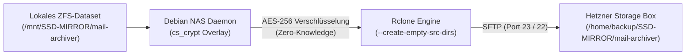

# Debian NAS (Debian 13 "Trixie" + Go + HTMX)

Ein kompromisslos schnelles, leichtgewichtiges NAS-Betriebssystem-Frontend und Daemon auf Basis von **Debian 13 (Trixie)**, nativer **OpenZFS**-Speicherarchitektur, **Samba**, **NFS** und **Rclone** – entwickelt für maximale Performance, intuitive Konfiguration und **echten, funktionierenden HDD-Standby**.

---

## Highlights

* **OpenMediaVault 6 / 7 Dark Dashboard Design:**
  * **Authentisches OMV-Designsystem:** Markante blaue Menüleiste (`#008be5`), dunkle Seitenleiste (`#181818`), Breadcrumb-Navigation (`🏠 | Dashboard`) und 3-spaltiges Dashboard-Raster.
  * **Echte Dashboard-Widgets:** CPU RRD-Graph, CPU-Auslastungs-Donut, konzentrische Load-Average-Ringe (1m, 5m, 15m), Memory-Donut (mit ZFS ARC-Erkennung), aktive Dienst-Pills (SSH, SMB, ZFS), Systemzeit, Uptime, Netzwerk-Interface-Übersicht und S.M.A.R.T.-Festplatten-Kacheln.
  * **100% englischsprachiges Web-Interface:** Durchgängig in englischer Sprache gehalten (Dashboard, Tabellen, Konfigurations-Modale und Benachrichtigungen).
* **Nativer OpenZFS-Unterbau (First-Class Core Engine):**
  * **Kein optionales Plugin:** Anders als bei OpenMediaVault, wo ZFS lediglich über Third-Party-Plugins (omv-extras) nachgerüstet wird, ist OpenZFS in **Debian NAS** das fundamentale, native Kernspeichersystem.
  * **Umfassende ZFS-Verwaltung:** Pools, VDEV-Topologien, Datasets, Zvols, Point-in-Time Snapshots, Klone, Scrubbing, TRIM und zerstörungsgeschützte Danger-Modals direkt integriert.
* **Modernes Zero-JavaScript-Build Frontend (Go + HTMX + Alpine.js + Idiomorph):**
  * **Kein Virtual-DOM- oder SPA-Ballast:** Saubere, modulare Go-Templates (`html/template`) statt monolithischem JavaScript.
  * **Flackerfreie Live-Telemetrie:** ZFS-Scrub-Fortschritt, Systemmetriken und Standby-Zustände werden via **Idiomorph DOM-Morphing** ohne Springen oder Fokusverlust aktualisiert.
  * **Alpine.js:** Leichtgewichtige Client-Zustände für Tabs, Modals, Slide-Over-Drawer und Toasts.
  * **Tailwind CSS v4:** Integriert über die offizielle Standalone CLI (kein Node.js / kein npm nötig).
* **HDD-Standby funktioniert wirklich:**
  * System- und Statusabfragen wecken schlafende Festplatten **niemals** auf (`smartctl -n standby` und non-intrusives `hdparm -C`).
  * Alle ZFS-Datasets werden standardmäßig mit **`atime=off`** angelegt, sodass Lesezugriffe die Festplatten nicht permanent wachhalten.
  * Automatisches Spindown-Management via `hd-idle` und konfigurierbare Timer.
* **Single-Binary-Architektur (Go):**
  * Der gesamte Daemon inklusive Web-UI (HTML-Templates, CSS, Icons, HTMX, Alpine) wird in **eine einzige statische Binärdatei** kompiliert (`nasd`).
  * Startzeit: < 10 Millisekunden.
  * RAM-Verbrauch im Leerlauf: **nur ca. 15–20 MB RSS**.
* **Volle OpenZFS-Enterprise-Features:**
  * **ZFS-Pools:** Status, Scrub-Steuerung, Kapazitätsanzeige, VDEV-Topologie, TRIM, Pool-Import/Export und zerstörungsgeschützte Danger-Modals.
  * **Datasets & Zvols:** Dateisysteme und Block-Volumes mit `lz4`/`zstd`-Kompression, Recordsize, Quota und Schreibschutz.
  * **Snapshots & Clones:** Unveränderliche Point-in-Time Schnappschüsse, 1-Klick-Rollback und beschreibbare Klone.
* **Dateifreigaben & Benutzerverwaltung:**
  * **Samba (SMB):** Inklusive nativer Windows-Netzwerkerkennung (`wsdd2` / `wsdd`), macOS Time Machine-Unterstützung und Multi-User-Zuordnung (Gast-Zugriff vs. eingeschränkte Benutzer).
  * **NFS Kernel Server:** Hohe I/O-Performance für Linux-Clients, Proxmox VE und Virtualisierung.
* **Cloud Sync Tasks nach TrueNAS-Vorbild (Bare-Metal Rclone Engine):**
  * **100% Linux-nativ & ohne Docker-Overhead:** Höchste Durchsatzraten und minimale Latenz durch direkte Rclone-Prozesssteuerung auf Debian 13.
  * **Multi-Cloud- & SFTP-Unterstützung:** Vorkonfigurierte Templates für **Hetzner Storage Box (SFTP)**, Nextcloud/ownCloud (WebDAV), Backblaze B2, Amazon S3 / S3-kompatible Speicher (MinIO, Wasabi, Cloudflare R2), Google Drive und Microsoft OneDrive.
  * **TrueNAS Standard Transfer-Modi:**
    * `COPY`: Kopiert neue und veränderte Dateien sicher zum Zielspeicher; bestehende Remote-Dateien werden niemals gelöscht (Safe Mode).
    * `SYNC`: Exakte 1:1 Spiegelung des ZFS-Datasets; auf der Quelle gelöschte Dateien werden auch auf dem Remote-Speicher bereinigt.
    * `MOVE`: Verschiebt Dateien nach erfolgreichem Upload und gibt lokalen Speicherplatz frei.
  * **Zero-Knowledge Client-Side Encryption (AES-256 Rclone Crypt):**
    * Lokale Ver- und Entschlüsselung direkt im NAS-Arbeitsspeicher vor dem Netzwerktransfer über dynamische Crypt-Overlays (`cs_crypt_<id>`). Der Cloud-Provider speichert ausschließlich unlesbare Chiffren.
    * Vollständige Trennung von Encryption Passphrase und kryptografischem Master Salt.
  * **Granulare Dateinamen-Verschlüsselung (Filename Encryption):**
    * `Off (Plain Names)`: Ordner- und Dateinamen bleiben auf Hetzner / Cloud im Klartext lesbar für perfekte Struktur und Übersicht – alle Dateiinhalte sind strikt AES-256-verschlüsselt.
    * `Standard`: Sowohl Dateinamen als auch Verzeichnisstrukturen werden vollständig unkenntlich verschlüsselt (EME-Standard).
    * `Obfuscate`: Dateinamen-Verschleierung für Systeme mit Zeichen- oder Längenbeschränkungen.
  * **1:1 ZFS-Dataset-Hierarchiemapping (`/backup/<Pool>/<Dataset>`):**
    * Automatische Pfad-Expansion und 1-Klick-Synchronisation (`🔄 Dataset Path`), sodass ZFS-Datasets sauber als getrennte Verzeichnisse auf dem Ziel angelegt werden (z. B. `/backup/SSD-MIRROR/Test/Test`).
  * **Replikation leerer Verzeichnisse (`--create-empty-src-dirs`):**
    * Auch neu angelegte, noch leere Ordner und ZFS-Datasets werden zuverlässig auf den Cloud-Speicher repliziert.
  * **Prozess-Tracking & Sofortiger Abbruch (Instant Abort):**
    * Laufende Transfers können per Klick auf `Abort` augenblicklich via POSIX-Signale (`SIGTERM`/`SIGKILL` & `pkill`) abgebrochen werden.
  * **Dry-Run Modus & Fehler-Tooltips:**
    * Risikoloses Testen von Synchronisationen mit `--dry-run` ohne Schreibzugriffe auf das Ziel, inklusive detaillierter Fehler-Tooltips (Exit-Codes und Rclone-Logs) direkt an den Status-Badges.
  * **Bandbreitenbegrenzung (`--bwlimit`) & Cron-Scheduler:**
    * Präzise Drosselung (z. B. `10M`, `50M`) und flexible Zeitpläne für automatische Nacht-Backups.
* **Hardware-Agnostisch:**
  * Identifiziert Disks über persistente Pfade (`/dev/disk/by-id/`).
  * 45Drives Houston Chassis & Drive-Bay Erkennung, SMART-Selbsttests und Locate-LED Steuerung.

---

## Projekt-Struktur

```text
Debian-Nas/
├── backend/
│   ├── cmd/nasd/main.go            # Daemon-Einstiegspunkt
│   ├── internal/
│   │   ├── api/                    # REST API & UI HTMX Handlers
│   │   │   ├── api.go
│   │   │   └── ui_handlers.go
│   │   ├── web/                    # Go Template Engine & Web-Assets
│   │   │   ├── web.go              # //go:embed templates/* & static/*
│   │   │   ├── templates/          # Modulare HTML-Templates
│   │   │   │   ├── layout.html     # Cockpit-Hauptlayout & Alpine State
│   │   │   │   ├── partials/       # Topbar, Metriken, Pools, Disks, Shares, etc.
│   │   │   │   └── modals/         # 13 Modaldialoge (Shares, Pools, Disks, Snaps)
│   │   │   └── static/             # Embedded Assets (HTMX, Alpine, CSS)
│   │   │       ├── htmx.min.js
│   │   │       ├── alpine.min.js
│   │   │       ├── idiomorph-ext.min.js
│   │   │       ├── tailwind.css    # Kompiliertes Tailwind CSS
│   │   │       ├── style.css       # PatternFly Enterprise Design System
│   │   │       └── input.css       # Tailwind Quell-CSS
│   │   ├── zfs/                    # OpenZFS Pools, Datasets, Scrubs & atime=off
│   │   ├── disks/                  # HDD-Erkennung, Standby-Check, SMART, Spindown
│   │   ├── shares/                 # Samba (smb.conf), NFS (/etc/exports) & User-Management
│   │   ├── cloudsync/              # Rclone-Integration (B2, Drive, S3, etc.)
│   │   ├── config/                 # Konfigurationsmanager
│   │   └── system/                 # Linux-Kernel Telemetrie & Netzwerk
│   ├── static/                     # Synchroner Asset-Spiegel
│   ├── go.mod
│   └── go.sum
├── debian/
│   ├── install.sh                  # 1-Klick Installer für Debian 13 (/opt/debian-nas)
│   └── nasd.service                # Systemd Service Unit
├── scripts/
│   ├── build-css.sh                # Tailwind Standalone CLI Builder (Linux)
│   └── build-css.ps1               # Tailwind Standalone CLI Builder (Windows)
├── Makefile                        # Build-, CSS- und Deployment-Skripte
└── README.md
```

---

## Schnellstart auf Debian 13 (Trixie)

### 1. Minimales Debian 13 installieren
Installiere Debian 13 (z. B. via Minimal-Netinst-ISO) auf einer dedizierten Boot-SSD/NVMe.

### 2. Projekt nach `/opt/debian-nas` klonen & Installer ausführen
```bash
sudo git clone https://github.com/MrCoopa/Debian-NAS.git /opt/debian-nas
cd /opt/debian-nas
sudo ./debian/install.sh
```

Das Skript:
1. Aktiviert `contrib` und `non-free-firmware` in den Paketquellen.
2. Installiert `zfsutils-linux`, `samba`, `wsdd2` (bzw. `wsdd`), `nfs-kernel-server`, `hd-idle`, `smartmontools`, `fio` und `rclone`.
3. Kompiliert die statische Go-Binärdatei nach `/opt/debian-nas/bin/nasd` (Symlink `/usr/local/bin/nasd`).
4. Konfiguriert Samba mit `/etc/samba/nas-shares.conf` und Windows-Discovery.
5. Richtet den Systemd-Service `nasd.service` ein und startet ihn sofort.

### 3. Web-Interface aufrufen
Öffne im Browser:
```text
http://<ip-deines-nas>:8080
```

---

## Aktualisierung auf einem bestehenden Server

Wenn du Änderungen aus dem Git-Repository übernehmen möchtest, reicht ein Einzeiler auf dem NAS:

```bash
cd /opt/debian-nas
git fetch origin main
git reset --hard origin/main
systemctl stop nasd.service
rm -f bin/nasd
cd backend && CGO_ENABLED=0 go build -v -ldflags="-s -w" -o ../bin/nasd ./cmd/nasd
cd /opt/debian-nas
systemctl start nasd.service
```

---

## TrueNAS & OpenZFS Pool-Migration (Feature-Flags & Upgrade-Guide)

Wenn ein ZFS-Pool von einem externen System (wie **TrueNAS SCALE ab Version 24.10 "Electric Eel"**) importiert werden soll, kann folgende Fehlermeldung auftreten:

```text
cannot import 'DATA': unsupported version or feature
This pool uses the following feature(s) not supported by this system:
com.truenas:block_cloning_endian (Fixes BRT ZAP endianness on new pools.)
All unsupported features are only required for writing to the pool.
The pool can be imported using '-o readonly=on'.
```

### Hintergrund
TrueNAS SCALE 24.10 nutzt OpenZFS 2.4+, welches das Feature `com.truenas:block_cloning_endian` aktiviert hat. Debian 13 (Trixie) liefert standardmäßig OpenZFS 2.3.9 aus. Da ZFS-Feature-Flags eine Einbahnstraße sind, verweigert OpenZFS 2.3 den beschreibbaren Import, um Datenkorruption zu verhindern.

### Weg A: Upgrade auf OpenZFS 2.4.4 (Vollständige Schreib- & Leserechte)
In Debian **Sid (Unstable)** ist OpenZFS **2.4.4** bereits fertig paketiert. Über **APT-Pinning** wird sichergestellt, dass **ausschließlich OpenZFS** aus Sid bezogen wird, während das Restsystem zu 100% stabil auf Debian 13 (Trixie) verbleibt:

```bash
# 1. Sid-Repository eintragen
echo "deb http://deb.debian.org/debian sid main contrib non-free-firmware" | sudo tee /etc/apt/sources.list.d/sid.list

# 2. APT-Pinning einrichten (Priorität 100 = Sid-Pakete werden nie automatisch installiert)
sudo tee /etc/apt/preferences.d/sid << 'EOF'
Package: *
Pin: release a=sid
Pin-Priority: 100
EOF

# 3. Paketlisten aktualisieren
sudo apt update

# 4. Kernel-Headers deines aktuellen Trixie-Kernels sicherstellen
sudo apt install -y linux-headers-$(uname -r)

# 5. OpenZFS 2.4 gezielt aus Sid installieren (baut das Kernelmodul für deinen 6.12 Kernel)
sudo apt install -t sid -y zfs-dkms zfsutils-linux

# 6. Sid-Quelle wieder entfernen (System bleibt 100% Trixie)
sudo rm -f /etc/apt/sources.list.d/sid.list /etc/apt/preferences.d/sid
sudo apt update

# 7. NAS neu starten, um das neu kompilierte Kernel-Modul zu laden
sudo reboot
```

Nach dem Neustart unterstützt dein System alle TrueNAS 24.10+ Features und der Pool kann ganz normal mit Lese- und Schreibrechten importiert werden:
```bash
zpool import DATA
```

### Weg B: Schreibgeschützter Import & Daten-Migration (Empfehlung für Standard-Debian)
Falls du dein System nicht mit Paketen aus Sid mischen möchtest:
1. **Schreibgeschützt importieren:**
   - In der WebUI: Beim Import-Dialog die Option **"Read-Only Import (-o readonly=on)"** anhaken.
   - Per CLI:
     ```bash
     zpool import -f -o readonly=on DATA
     zfs mount -a
     ```
2. **Daten auf den Hauptpool sichern:**
   ```bash
   rsync -avP /mnt/DATA/ /mnt/MEDIA-12TB/data/
   ```
3. **Pool zerstören und auf Debian neu anlegen:**
   ```bash
   zpool destroy DATA
   ```
   Danach in der WebUI unter **Storage Pools -> Create Pool** den Pool neu anlegen. Er ist dann 100% nativ mit Debian 13 kompatibel.

---

## HDD-Standby & Power Management Guide

Debian NAS wurde von Grund auf dafür entwickelt, **echten, funktionierenden HDD-Standby** zu gewährleisten:

1. **Non-intrusive Statusabfragen:**
   Das System nutzt für Dashboard- und Disk-Status-Abfragen ausschließlich `smartctl -n standby -i <disk>` und `hdparm -C <disk>`. Diese Befehle lesen den Status aus dem Controller-Cache, **ohne** schlafende Spindeln aufzuwecken.
2. **S.M.A.R.T.-Daemon Schutz (`smartd`):**
   Der S.M.A.R.T.-Hintergrundüberwachungsdienst (`smartd`) wird in `/etc/smartd.conf` automatisch mit `-n standby` konfiguriert:
   ```text
   DEVICESCAN -d removable -n standby -m root -M exec /usr/share/smartmontools/smartd-runner
   ```
   Dadurch werden Festplatten nicht alle 30 Minuten für Telemetrie-Checks geweckt.
3. **ZFS `atime=off`:**
   Alle über die WebUI erstellten Datasets setzen standardmäßig `atime=off`. Dadurch führen reine Lesezugriffe nicht zu Schreiboperationen für Zugriffszeitstempel.
4. **Spindown-Timer via `hd-idle`:**
   In `/etc/default/hd-idle` wird der Spindown-Timer (z. B. 900 Sekunden = 15 Minuten) hinterlegt. Die WebUI erlaubt zusätzlich die granulare Steuerung pro Festplatte (Always On, 5 Min, 10 Min, 15 Min, 30 Min, 1 Std, 2 Std).
5. **Schutz vor ZFS "SUSPENDED" beim Aufwachen (SCSI Device Timeout & failmode):**
   * **Problemstellung:** Große Helium- oder Enterprise-HDDs (wie 12TB–22TB) besitzen 8–10 Magnetscheiben. Das Hochdrehen aus dem Standby dauert **12 bis 18 Sekunden**. Standardmäßig bricht der Linux-Kernel I/O-Befehle bereits nach 30 Sekunden ab, wenn ein SATA-Handshake leicht verzögert wird. OpenZFS erhält dadurch einen temporären I/O-Error und versetzt den gesamten Pool in den Zustand `SUSPENDED` (`failmode=wait`), wodurch alle Zugriffe (z. B. von Jellyfin via NFS) einfrieren.
   * **Lösung in Debian NAS:**
     1. **Automatischer 120s SCSI-Timeout:** Das System setzt den Kernel-Block-Timeout für alle rotierenden HDDs (`/sys/block/sdX/device/timeout`) automatisch auf **120 Sekunden** (via `/etc/udev/rules.d/99-zfs-spindown-timeout.rules` und Daemon-Erkennung). Der Kernel wartet geduldig, bis die Spindel die volle Drehzahl erreicht hat.
     2. **SATA ALPM auf `max_performance`:** Verhindert das Einschlafen der SATA-Leitung (PHY-Link) bei schlafender Spindel, wodurch `COMRESET`-Abbrüche beim Aufwachen vermieden werden.
     3. **Pool `failmode=continue`:** Unter **Storage Pools -> Properties** kann `failmode=continue` gewählt werden. ZFS wiederholt I/O-Anfragen geduldig und suspendiert den Pool bei Anlaufverzögerungen niemals.
     4. **1-Klick Resume:** Sollte ein Pool im Notfall suspendiert sein, lässt er sich mit einem Klick auf **⚡ Resume Pool** (oder per CLI `zpool clear <pool>`) sofort wiederbeleben.

6. **Globale APM-Deaktivierung (Firmware-Timer & unkontrollierte Wake-ups verhindern):**
   * **Problemstellung:** Interne Advanced Power Management (APM) Timer moderner Festplatten-Firmwares (speziell Western Digital Red / Plus / Pro / Ultrastar) parken Leseköpfe oder führen zyklische interne Checks durch, die alle 30 Minuten zu einem ungewollten Aufwachen der Festplatte führen. Dies kollidiert mit `hd-idle`. Zudem vergessen SATA/SAS-Platten diese Einstellung bei einem Stromverlust oder Reboot.
   * **Lösung in Debian NAS:** Ein automatisierter `@reboot`-Root-Cronjob deaktiviert APM bei jedem Bootvorgang global auf allen mechanischen Festplatten via:
     ```bash
     @reboot for dev in /dev/sd[a-z]; do /usr/sbin/smartctl -s apm,off $dev 2>/dev/null; done
     ```
     Fehlermeldungen bei SSDs oder inkompatiblen Controllern werden lautlos ignoriert.

---

## Netzwerkdienste & Windows Discovery

* **Windows 10/11 Explorer Network Discovery (`wsdd2`):**
  Unter Debian 13 (Trixie) wurde das alte Python-Paket `wsdd` durch das native, ressourcensparende C-Paket `wsdd2` ersetzt. Es wird vom Installer automatisch eingerichtet und gestartet, sodass das NAS im Windows-Explorer unter „Netzwerk“ sofort erscheint.
* **Samba (SMB) Freigaben:**
  Konfiguriert über `/etc/samba/nas-shares.conf`. Unterstützt Gast-Zugriff, Benutzerbeschränkungen (Gruppe `nasusers`) und macOS Time Machine.
* **NFS Kernel Server:**
  Exports unter `/etc/exports.d/` für latenzarme Linux- und Proxmox-Verbindungen.

---

## ZFS Snapshot Management & Paginierung

* **Pool-Gruppierung:** Snapshots werden automatisch nach Speicherpool gruppiert und in separaten Tabellen dargestellt.
* **Server-Side Pagination:** Um bei Dutzenden oder Hunderten automatischen Snapshots den Browser nicht zu überlasten, liefert das Backend exakt **10 Snapshots pro Seite** aus.
* **Live-Filter & Aktionen:** Snapshots lassen sich pro Pool in Echtzeit durchsuchen, auf Knopfdruck zurückrollen (`Rollback`), klonen (`Clone`) oder löschen (`Destroy`).

---

## Cloud Sync & Hetzner Storage Box Guide (TrueNAS-Style Offsite-Replication)

Debian NAS implementiert ein hochperformantes, an **TrueNAS SCALE angelehntes Cloud Sync Subsystem**, das direkt auf der nativen **Rclone-Engine** im Debian-Betriebssystem aufsetzt (ohne ressourcenhungrige Container). Es ermöglicht automatisierte, verschlüsselte Offsite-Backups deiner ZFS-Datasets zu externen Cloud-Zielen wie der **Hetzner Storage Box**, WebDAV/Nextcloud, Amazon S3 oder Backblaze B2.



---

### 1. Cloud Credential einrichten (am Beispiel Hetzner Storage Box SFTP)

Hetzner Storage Boxen bieten kostengünstigen, hochverfügbaren Speicher mit nativer SFTP/SSH-Unterstützung.

1. Öffne in der WebUI den Bereich **Cloud Sync Tasks** und klicke auf **+ Add Credential** (oder in der Sektion *Cloud Credentials* auf **Add**).
2. Wähle als **Provider:** `Hetzner Storage Box / SFTP`.
3. Fülle die Verbindungsdaten aus:
   * **Name:** Ein eindeutiger Identifier ohne Sonderzeichen oder Leerzeichen (z. B. `Hetzner` oder `StorageBox`).
   * **Host:** Dein zugewiesener Hostname, z. B. `uXXXXXX.your-storagebox.de`.
   * **User:** Dein Storage-Box Benutzername, z. B. `uXXXXXX`.
   * **Port:** Standardmäßig `23` (Hetzner SFTP-Port) oder `22`.
   * **Password:** Dein Storage-Box-Passwort oder SSH-Schlüssel.
4. **Automatischer Host-Key-Schutz:** Debian NAS übergibt automatisch `known_hosts_file=none`. Dadurch bleibt der Hintergrund-Daemon niemals an interaktiven SSH-Fingerprint-Bestätigungen hängen, und automatische Tasks laufen unterbrechungsfrei durch.
5. Klicke auf **Test Connection**, um die Verbindung sofort live zu verifizieren, und speichere mit **Save Credential**.

---

### 2. Cloud Sync Task konfigurieren

Klicke in der Tabelle *Cloud Sync Tasks* auf **Add**, um eine neue Synchronisationsaufgabe anzulegen:

| Feld | Erklärung & Best Practices |
| :--- | :--- |
| **Description / Task Name** | Aussagekräftiger Name (z. B. `Mail-Archiver --> Hetzner Upload`). |
| **Direction** | **`PUSH (Local NAS → Cloud)`** für reguläre Offsite-Backups.<br/>**`PULL (Cloud → Local NAS)`** für Restore-Prozesse und Disaster Recovery. |
| **Transfer Mode** | **`COPY (Safe - copy new/changed files only)`**: Kopiert neue oder geänderte Dateien. Auf dem Ziel bereits existierende Dateien werden *niemals* gelöscht. Ideal für unberührbare Langzeit-Backups.<br/>**`SYNC (Exact mirror)`**: Spiegelt das Dataset 1:1. Dateien, die lokal gelöscht wurden, werden auch auf der Cloud entfernt.<br/>**`MOVE`**: Verschiebt Dateien (löscht die lokale Quelldatei nach erfolgreichem Transfer). |
| **Local Source Dataset** | Das zu sichernde ZFS-Dataset (z. B. `/mnt/SSD-MIRROR/Test` oder `/mnt/DATA/Nextcloud`). Das Backend normalisiert Pfade bei Bedarf automatisch auf den korrekten `/mnt/`-Mountpunkt (*Self-Healing*). |
| **Remote Credential** | Das zuvor angelegte Remote (z. B. `Hetzner (sftp)`). |
| **Remote Folder / Subpath** | Zielverzeichnis auf dem Remote-Speicher (z. B. `/backup/SSD-MIRROR/Test`). |
| **Bandwidth Limit** | Optionale Begrenzung des Uploads (z. B. `50M` für 50 MB/s, `10M` oder `0` für unbegrenzt). |
| **Frequency / Schedule** | Zeitplan nach Cron-Standard (z. B. *Daily at 02:00 AM* oder benutzerdefinierte Intervalle). |

---

### 3. ZFS-Dataset-Hierarchiemapping & leere Verzeichnisse

Rclone überträgt standardmäßig den **Inhalt** des Quellordners. Würde man als Ziel nur `/backup` angeben, würden die Dateien aus `/mnt/SSD-MIRROR/Test/` direkt lose in `/backup/` auf der Storage Box abgelegt – der Ordnername `Test` ginge verloren.

Debian NAS löst dieses Verhalten durch **vollautomatische Pfadhierarchie**:
* Bei Auswahl eines Quell-Datasets (z. B. `/mnt/SSD-MIRROR/Test`) berechnet das System automatisch:
  $$\text{Remote Subpath} = \text{/backup/} + \langle\text{Pool}\rangle + \text{/} + \langle\text{Dataset}\rangle$$
* Beispiel: Das Quell-Dataset `/mnt/SSD-MIRROR/Test` wird zielgerichtet nach `/backup/SSD-MIRROR/Test` geschrieben. Auf der Hetzner Storage Box entsteht exakt die saubere ZFS-Struktur:
  ```text
  /home/backup/
  └── SSD-MIRROR/
      ├── mail-archiver/
      │   └── ...
      └── Test/
          └── Test/
  ```
* **Button `🔄 Dataset Path`:** Ermöglicht bei nachträglichem Ändern des Quell-Datasets das sofortige Neuberechnen des optimalen Remote-Pfades mit einem Klick.
* **Leere Ordner (`--create-empty-src-dirs`):** Debian NAS übergibt standardmäßig den Parameter `--create-empty-src-dirs`. Dadurch werden auch leere Unterordner und frisch erstellte, noch unbefüllte ZFS-Datasets zuverlässig auf dem Remote-Speicher abgebildet.

---

### 4. Zero-Knowledge Client-Side Encryption (AES-256 Rclone Crypt)

Debian NAS schützt deine Daten auf externen Servern durch echte **Client-Side-Verschlüsselung**. Die Daten werden lokal auf deinem NAS im RAM verschlüsselt, bevor sie über die Netzwerkschnittstelle gesendet werden. Der Cloud-Provider speichert ausnahmslos unlesbare Chiffren.

#### Funktionsweise unter der Haube
Wird die Option **🔒 Client-Side Encryption** aktiviert, registriert der Daemon zur Laufzeit ein dynamisches, task-spezifisches Rclone-Crypt-Remote (`cs_crypt_<taskID>`), das als transparente Verschlüsselungsschicht vor das Ziel geschaltet wird.

#### Schlüsselverwaltung
* **Encryption Password:** Deine primäre Passphrase. Im Bearbeiten-Dialog (`Edit Cloud Sync Task`) wird das gespeicherte Passwort geladen und kann über das **👁️ Show / Hide**-Icon ein- und ausgeblendet werden.
* **Master Salt:** Ein zweiter, unabhängiger Salt (Passphrase 2). Er verhindert Wörterbuch- und Rainbow-Table-Angriffe.

#### Filename Encryption (Dateinamen-Verschlüsselung)
Debian NAS bietet drei Betriebsmodi für Dateinamen:

1. **`Off (Plain Names)` (Empfehlung für Hetzner Storage Box):**
   * **Dateiinhalte:** Zu 100% kryptografisch sicher mit **AES-256-CTR** verschlüsselt. Niemand bei Hetzner kann Dateiinhalte einsehen.
   * **Ordner- & Dateinamen:** Bleiben im Klartext lesbar (`rechnung_2026.pdf`, `Test/`, `mail-archiver/`).
   * **Vorteil:** Du behältst über SSH (`ls -la`), SFTP oder den Hetzner Web-Dateimanager den vollen Überblick über deine Backups und Ordnerstrukturen, während der Inhalt unlesbar geschützt ist.
2. **`Standard`:**
   * Sowohl Dateiinhalte als auch Dateinamen und Verzeichnisstrukturen werden mit **AES-256-EME** unkenntlich verschlüsselt (z. B. `7k9f2b8a.../3p8m1c...`).
   * **Vorteil:** Maximale Vertraulichkeit. Außenstehende können weder Dateinamen noch Rückschlüsse auf Dateitypen ziehen.
3. **`Obfuscate`:**
   * Einfache Obfuskation für Zielsysteme mit Zeichenbeschränkungen.

---

### 5. Task-Steuerung, Live-Monitoring & Sofort-Abbruch

* **Dry-Run Modus (`DRY`):**
  * Mit der Option *Dry-Run* führt Rclone einen Simulationslauf (`--dry-run`) durch. Es wird exakt geprüft und protokolliert, welche Dateien übertragen, geändert oder gelöscht würden, ohne Schreiboperationen auf dem Ziel auszuführen.
* **Sofortiger Abbruch (`Abort`):**
  * Soll ein laufender Upload gestoppt werden (z. B. bei versehentlich gestartetem Großtransfer), beendet ein Klick auf **Abort** den Prozess unverzüglich über Betriebssystem-Signale (`SIGTERM` / `SIGKILL` / `pkill`). Der Task wird sauber in den Status `FAILED (Aborted by user)` überführt.
* **Fehler-Tooltips (Error Inspection):**
  * Schlägt ein Sync fehl (z. B. wegen falscher Zugangsdaten, voller Storage Box oder fehlerhaftem Pfad), wird das `Failed`-Badge mit einem roten Warnrahmen markiert. Ein Mouse-Hover über das Badge öffnet einen detaillierten Tooltip mit dem exakten Rclone-Exit-Status und der Fehlermeldung.

---

### 6. Notfall-Wiederherstellung (Disaster Recovery & Restore)

Sollte dein NAS ausfallen oder Daten versehentlich gelöscht werden, können die Backups auf zwei Wegen wiederhergestellt werden:

#### Methode A: Über die Debian NAS WebUI (PULL Task)
1. Erstelle einen neuen Task mit **Direction:** `PULL (Cloud → Local NAS)`.
2. Wähle als Quelle das entsprechende Remote und den Subpath (z. B. `/backup/SSD-MIRROR/mail-archiver`).
3. Wähle als lokales Ziel das gewünschte ZFS-Dataset (z. B. `/mnt/SSD-MIRROR/mail-archiver`).
4. Aktiviere bei verschlüsselten Backups **Client-Side Encryption** und trage dieselbe Passphrase und dasselbe Salt ein.
5. Klicke auf **Run Now** – alle Daten werden aus der Cloud heruntergeladen, transparent entschlüsselt und in dein ZFS-Dataset geschrieben.

#### Methode B: Manuell auf jedem beliebigen Linux-/macOS-/Windows-Rechner via Rclone CLI
Da Debian NAS auf standardisiertem Rclone Crypt aufbaut, bist du **nicht** an Debian NAS gebunden und kannst deine Daten jederzeit mit puren Rclone-Befehlen wiederherstellen:

```bash
# 1. Rclone installieren (falls noch nicht vorhanden)
sudo apt update && sudo apt install -y rclone

# 2. Hetzner Storage Box Remote manuell einrichten
rclone config create Hetzner sftp \
    host="uXXXXXX.your-storagebox.de" \
    user="uXXXXXX" \
    port=23 \
    pass="DEIN_STORAGEBOX_PASSWORT" \
    known_hosts_file="none"

# 3. Bei Client-Side Encryption: Crypt-Overlay definieren
# (Bei Filename Encryption 'Off' setze filename_encryption=off)
rclone config create RestoreCrypt crypt \
    remote="Hetzner:backup/SSD-MIRROR/mail-archiver" \
    password="DEIN_VERSCHLUESSELUNGS_PASSWORT" \
    salt="DEIN_MASTER_SALT" \
    filename_encryption="off"

# 4. Daten transparent entschlüsselt in ein lokales Verzeichnis kopieren
rclone copy RestoreCrypt: /mnt/RESTORE/mail-archiver -P --create-empty-src-dirs
```

---

## Tailwind CSS & Styling (Zero Node.js)

Das System nutzt Tailwind CSS v4 über die offizielle **Standalone CLI** von Tailwind Labs. Du benötigst weder Node.js noch npm:

### Auf Linux / Debian:
```bash
make css         # Kompiliert und minifiziert tailwind.css
make watch-css   # Live-Watcher: Kompiliert bei Template-Änderungen automatisch neu
```

### Auf Windows (PowerShell):
```powershell
.\scripts\build-css.ps1         # Einmaliger Build
.\scripts\build-css.ps1 -Watch  # Live-Watcher
```

Die fertige Datei `tailwind.css` ist bereits im Repository eingecheckt und wird beim `go build` direkt in die Binary eingebettet.

---

## Lokales Testen (Mock-Modus)

Du kannst den Daemon auch auf jedem Entwicklungsrechner (auch unter Windows/macOS ohne ZFS) im **Mock-Modus** starten:

```bash
cd backend
go run cmd/nasd/main.go -mock -port 8080
```
Rufe anschließend `http://localhost:8080` auf. Die GUI simuliert Festplatten, ZFS-Pools, I/O-Raten und SMART-Daten komplett im Speicher.

---

## Tests ausführen

Das gesamte Backend verfügt über eine vollständige Test-Suite für ZFS, Disks, Shares, User-Rechte, Templates und UI-Endpunkte:

```bash
cd backend
go test -v ./...
```
